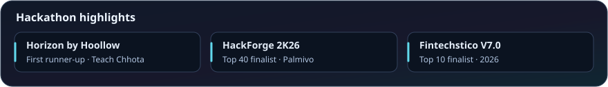

<h1 align="center">Hi, I'm Aniket Sidhu</h1>

  <strong>Applied AI · Computer Vision · Full-Stack Engineering</strong> 
  B.Tech Information Technology at MSIT, GGSIPU · New Delhi, India

  

## About me

I build applied AI systems that turn model outputs into tools people can use. My recent work spans gesture-controlled 3D design, explainable machine learning, and AI for education. I'm pursuing a B.Tech in Information Technology at MSIT (expected 2028), with an **8.73/10 CGPA through semester four**.

As a **Machine Learning Intern at CodeAlpha** (Aug–Sep 2026), I built [MedPredict AI](https://github.com/aniketsidhu123/CodeAlpha_Disease_Prediction_Model) and an [explainable credit scoring pipeline](https://github.com/aniketsidhu123/CodeAlpha_Credit_Scoring_Model) using FastAPI, SHAP, and interactive dashboards.

## GitHub activity

  

  

  

  

## Selected work

| Project | What it does |
| --- | --- |
| [**Palmivo**](https://github.com/aniketsidhu123/Palmivo) | Browser-based CAD controlled by webcam hand gestures, with on-device inference and STL/OBJ export. **HackForge 2K26 Top 40 finalist.** |
| [**ExoScope**](https://github.com/aniketsidhu123/Planetary_Biosignature) | Explains exoplanet habitability and biosignature scores using NASA Exoplanet Archive data, calibrated models, and SHAP. |
| [**Teach Chhota**](https://github.com/aniketsidhu123/Teach-Chhota) | Team-built learning companion where students teach an AI and get Gemini feedback grounded in NCERT material. **Horizon by Hoollow first runner-up.** |
| [**KAVACH Risk Command Center**](https://github.com/Arpitgit06/NSUT-Finance) | Team-built fintech workspace that combines fraud and loan-default scores with 3D risk visualization and fairness analysis. |
| [**Tracelight**](https://github.com/aniketsidhu123/CodeCubicle) | Runs Qwen2.5 locally and streams structured web research into a dashboard with CSV and JSON export. |
| [**TESSERACTZ**](https://github.com/aniketsidhu123/ISRO_Hackathon_IR_Enhancement) | ISRO hackathon team project for enhancing infrared satellite imagery with super-resolution, colorization, and object detection. |
| [**Crowd Flow Optimiser**](https://github.com/aniketsidhu123/GrandPrixGeekRoom) | Crowd digital twin that combines vision and simulation for live density maps, bottleneck forecasting, and rerouting. |

## Languages and tools

| Area | Stack |
| --- | --- |
| Languages |  Python, JavaScript, TypeScript, HTML, CSS |
| AI and machine learning |  PyTorch, TensorFlow/Keras, scikit-learn, OpenCV, YOLOv8, XGBoost, SHAP, Gemini, RAG |
| Web and APIs |  React, Vite, Node.js, Express, FastAPI, Flask, Tailwind CSS, Three.js, Streamlit |
| Data and delivery |  Pandas, NumPy, Git, GitHub Actions, Docker |

<strong>More recognition and credentials</strong>

- Smart India Hackathon 2025 nominee, Team CODEFORGE
- IEEE MSIT Decode Dilemma finalist
- Claude Code 101 from Anthropic and Introduction to Generative AI from Google Cloud
- Forage job simulations from Tata, Walmart Global Tech, and Deloitte

## Connect with me

  <a href="https://portfolio-website-ai-rosy.vercel.app/">Portfolio</a>
  · <a href="https://www.linkedin.com/in/aniket-sidhu-9bb180373/">LinkedIn</a>
  · <a href="mailto:aniketsidhu425@gmail.com">Email</a>

  

Layout inspired by the <a href="https://gitskins.com/readme-builder?theme=github-dark&amp;template=recruiter">GitSkins creative dev template</a>. Skill icons by <a href="https://github.com/tandpfun/skill-icons">Skill Icons</a>.
