### `aniket@github ~ $ whoami`

 

### `aniket@github ~ $ ./activity`

### `aniket@github ~ $ ls projects/`

| Project | Explore |
| :--- | :--- |
| **GrandPrixGeekRoom** | [Crowd simulation, bottleneck forecasting & automated rerouting](https://github.com/aniketsidhu123/GrandPrixGeekRoom) |
| **Security Camera** | [Python security camera project](https://github.com/aniketsidhu123/security-camera) |
| **AI Portfolio** | [AI engineer & full-stack developer portfolio](https://github.com/aniketsidhu123/portfolio-website-ai) |

[Browse my repositories →](https://github.com/aniketsidhu123?tab=repositories)

<!-- Edit profile.json and run node scripts/build.mjs to regenerate the cards. -->
